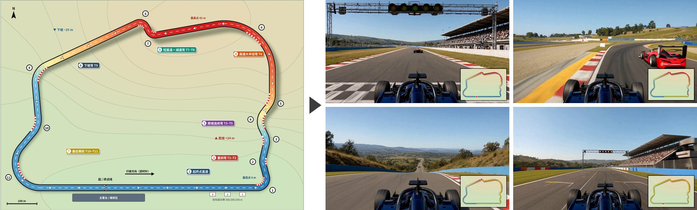

# 开上你的梦幻赛道：用 AI 分镜跑完一圈

[English](README.md)



手里有一张自己设计的赛道俯视图，怎么生成一段车手第一视角的视频，把它完整跑一圈？

本项目从最直接的办法（一个提示词）开始，一步步引入分镜、关键帧和逐段生成，拼出约 1 分钟、带赛段标题和小地图的成片，再用分镜修好其中最难的减速弯。所有生成都在 ComfyUI 里完成：关键帧用 Qwen Image 2.1，视频用 MiniMax H3 首尾帧，两者都在云端推理。只有统一关键帧车身的编辑用本地 Qwen Image 2.1 模型，需要 GPU；没有 GPU 时可以用自带素材跳过这一步。

每一步都附有已经生成好的关键帧和视频，可以直接用它们快速拼出成片，也可以自己重新生成。

## 章节

| 章节 | 内容 | 讲解提纲 | 要生成的内容 |
|---|---|---|---|
| 1 | 认识赛道地图，提出任务 | [ch1_map](docs/ch1_map.md) | 无 |
| 2 | 一个提示词直接生成：15 秒、跑不完、不可控 | [ch2_single_prompt](docs/ch2_single_prompt.md) | 每次 1 段视频（可选） |
| 3 | 分镜：把一圈拆成 7 个镜头 | [ch3_storyboard](docs/ch3_storyboard.md) | 无 |
| 4 | 关键帧：每个镜头交界处一张车手视角图，对照分镜检查，再统一车身 | [ch4_keyframes](docs/ch4_keyframes.md) | 8 张图起，每改一次多 1 张（可选）；统一车身在本地 GPU 上跑 |
| 5 | 逐段拍镜头：首尾帧生成视频 | [ch5_shots](docs/ch5_shots.md) | 最多 14 段视频（可选） |
| 6 | 拼接成片，找问题 | [ch6_problems](docs/ch6_problems.md) | 无 |
| 7 | 用分镜修好 T7–T8 减速弯 | [ch7_chicane](docs/ch7_chicane.md) | 2 张图 + 6 段视频（可选） |
| 8 | 总结和练习 | [ch8_wrapup](docs/ch8_wrapup.md) | 练习按需 |

## 运行方式

三种方式任选其一：

| 方式 | 适合谁 | 需要什么 |
|---|---|---|
| [一：直接用 ComfyUI](#方式一直接用-comfyui) | 熟悉 ComfyUI，只想复现工作流 | 本地 ComfyUI（Windows / Linux） |
| [二：本地 notebook](#方式二本地-notebook) | 想边看讲解边做，本地已有 ComfyUI | 本地 ComfyUI + JupyterLab |
| [三：云端 notebook](#方式三云端-notebook) | 不想在本地搭环境 | 平台提供的、预装 ComfyUI 的 JupyterLab |

三种方式都要一个 H3 key：到 https://h3.oneclickamd.ai 注册获取。key 放在 ComfyUI 的 `user/h3_gateway_api_key.txt`（两个 notebook 会提示你输入并写入）或环境变量 `H3_GATEWAY_API_KEY`。节点没有 key 输入框，key 不会写进工作流或视频元数据。

两个 notebook 内容相同，只是准备环境的部分不同。notebook 里每一步都可以直接用自带素材（路线 A），也可以在 ComfyUI 里自己生成后回到 notebook 挑选（路线 B）。

### 方式一：直接用 ComfyUI

下面的 `python`、`pip` 都要用运行 ComfyUI 的那个 Python 环境。Windows 便携版在 `dream-circuit-lap` 目录里把 `python` 换成 `..\..\python_embeded\python.exe`，把 `pip` 换成 `..\..\python_embeded\python.exe -m pip`。

**1. 准备 ComfyUI 和两个节点。** 还没装 ComfyUI 的话，按 [官方说明](https://github.com/Comfy-Org/ComfyUI#installing) 安装。然后装两个云端节点：

```bash
cd ComfyUI/custom_nodes
git clone https://github.com/wangxunx/ComfyUI-AMD-Qwen-Image-2.1.git
git clone https://github.com/wangxunx/ComfyUI-AMD-MiniMaxH3.git
```

**2. 写入 H3 key。** 新建文本文件 `ComfyUI/user/h3_gateway_api_key.txt`，内容只有 key 这一行。

**3. 下载本项目并安装工作流。** 本项目要放在 ComfyUI 目录里：

```bash
cd ComfyUI
git clone https://github.com/wangxunx/dream-circuit-lap.git
cd dream-circuit-lap
pip install -r requirements.txt
python scripts/fetch_media.py --fonts                               # 自带素材（media/，约 72 MB）和中文字体
python scripts/make_workflows.py --install                          # 第 4–6 章的 7 镜头工作流
python scripts/make_workflows.py --shots lap_8shots.json --install  # 第 7 章的 8 镜头工作流
```

**4. 启动 ComfyUI。** 在 ComfyUI 目录运行 `python main.py`（Windows 便携版双击 GPU 版的启动脚本）。没有 GPU 时用 CPU 模式：`python main.py --cpu`（便携版 `run_cpu.bat`），这时第 4、7 章统一车身的编辑跑不了，用自带素材即可。浏览器打开 http://127.0.0.1:8188（第一次打开会弹出 Templates 模板窗口，点右上角 × 关掉）。按 `w` 打开左侧的工作流列表，能看到 `dream7_*` 和 `dream8_*`。ComfyUI 是在装节点之前启动的，要先重启；看不到工作流就按 F5 刷新页面。

**5. 按章节复现。** 每个工作流左边的黄色说明节点写着运行前要准备什么；每个镜头的首尾帧、提示词和复制命令也汇总在 [storyboard_dream7.md](docs/storyboard_dream7.md) 和 [storyboard_dream8.md](docs/storyboard_dream8.md)。

| 章节 | 在 ComfyUI 里 | 生成后要做的 | 直接用自带素材 |
|---|---|---|---|
| 2 | 把 `workflows/ch2_single_prompt.json` 拖进画布，在 Load Image 节点点 “choose file to upload” 选 `assets/fictional_track_v1.png`，点 Run | 无 | 看 `media/ch2_single_prompt_*.mp4` |
| 4 | 打开 `dream7_keyframes_pilot`（先试 K0、K1），再打开 `dream7_keyframes`，点 Run；对照分镜检查，不对就改提示词开头的场景描述再 Run | 定稿的图从 `ComfyUI/output/dream7/` 复制到 `ComfyUI/input/`，改名为 `dream7_K0.png` … `dream7_K7.png`；再打开 `dream7_keyframes_edit` 点 Run，以 K1 为参考统一 K0、K2–K7 的车身（本地模型，缺的话 ComfyUI 会提示下载），检查后用 `K*_edit_*.png` 覆盖 `input/` 里的关键帧 | 把 `examples/keyframes/dream7_K*.png` 复制到 `ComfyUI/input/`（已经统一过车身，自带视频就是用它们拍的） |
| 5 | 按 F5 刷新，依次打开 `dream7_shot_01` … `dream7_shot_07`，点 Run | 选中的视频从 `ComfyUI/output/video/dream7/` 复制为 `ComfyUI/output/video/dream7/selected/shot_01.mp4` … | 把 `media/dream7_shot_0X.mp4` 复制为同样的文件名 |
| 6 | 无 | 运行 `python scripts/stitch_lap.py`，成片在本项目目录的 `output/dream_circuit_7shots.mp4` | 同左 |
| 7 | 打开 `dream8_keyframes`，点 Run 生成 K4、K5；对照分镜检查，不对就改提示词开头的场景描述再 Run | 定稿的图从 `ComfyUI/output/dream8/` 复制到 `ComfyUI/input/`，改名为 `dream8_K4.png`、`dream8_K5.png`；再打开 `dream8_keyframes_edit` 点 Run，以 `input/dream7_K1.png` 为参考统一 K4、K5 的车身，检查后用 `K4_edit_*.png`、`K5_edit_*.png` 覆盖 `input/` 里的这两张。按 F5 刷新，依次打开 `dream8_shot_04` … `dream8_shot_06` 点 Run，选中的视频从 `ComfyUI/output/video/dream8/` 复制为 `ComfyUI/output/video/dream8/selected/shot_04.mp4` … `shot_06.mp4`；其余镜头直接复用第 5 章 `ComfyUI/output/video/dream7/selected/` 里的视频。最后运行 `python scripts/stitch_lap.py --shots lap_8shots.json`，成片在本项目目录的 `output/dream_circuit_8shots.mp4` | 把 `examples/keyframes/dream8_K4.png`、`dream8_K5.png` 复制到 `ComfyUI/input/`，把 `media/dream8_shot_04.mp4` … `dream8_shot_06.mp4` 复制为 `ComfyUI/output/video/dream8/selected/shot_04.mp4` … `shot_06.mp4`，再运行同样的拼接命令 |

Load Image 节点被红框圈住、右上角提示 “Media input missing” 或 “errors found”，说明它要读的图片还不在 `ComfyUI/input/`：把图片放进去后按 F5 刷新页面。
`stitch_lap.py` 还支持 `--en`（英文标题）、`--no-minimap`（去掉小地图）和 `--placeholder`（缺镜头时用占位画面预览）。

### 方式二：本地 notebook

需要本地已经装好 ComfyUI，并用 conda 或 venv 管理它的 Python 环境；两个节点和 H3 key 由 notebook 安装和写入。Windows 便携版的内嵌 Python 不适合装 JupyterLab，建议用方式一或方式三。

**1. 在终端启动 JupyterLab：**

```bash
conda activate comfyui                 # 换成你运行 ComfyUI 的环境
cd /path/to/ComfyUI
git clone https://github.com/wangxunx/dream-circuit-lap.git
cd dream-circuit-lap
pip install jupyterlab -r requirements.txt
jupyter lab --ServerApp.root_dir=. notebooks/local.ipynb
```

`--ServerApp.root_dir=.` 不能省：只写文件名时 JupyterLab 以 `notebooks/` 为根目录，notebook 里的视频会 404、无法播放。ComfyUI 不在本项目的上一级目录时，启动前设置环境变量 `COMFYUI_DIR`。

**2. 打开 JupyterLab。** 用浏览器打开终端里打印的 `http://127.0.0.1:8888/lab?token=...`。在远程机器上运行时（例如 Cursor / VS Code 的 Remote SSH），编辑器一般会自动转发这个端口；打不开的话，在 Ports 面板手动添加 8888。

**3. 运行第 0 节。** 从第一格开始，点中一格按 `Shift+Enter`，逐格往下运行。安装节点、配置 key 时，已经装好、配好的会直接跳过；没有 key 时输出区会出现输入框，粘贴 key 后按回车。启动 ComfyUI 那一格要等十几秒。8188 端口已经有 ComfyUI 在运行时，notebook 直接用它；它是在装节点之前启动的话，要先重启。

**4. 打开 ComfyUI。** 浏览器打开 http://127.0.0.1:8188，第一次打开会弹出 Templates 模板窗口，点右上角 × 关掉。打不开的话，在 Ports 面板添加 8188：它是 notebook 在后台启动的，编辑器可能不会自动转发。

**5. 运行“准备素材”。** 之后在 ComfyUI 里按 `w` 打开左侧的工作流列表，能看到 `ch2_single_prompt`、`dream7_*`、`dream8_*`。没看到就按 F5 刷新。

**6. 第一遍建议走路线 A。** 一路按 `Shift+Enter` 到底，用自带素材就能看到所有历史视频和两部成片。

**7. 第二遍试路线 B。** 从第 4 章开始，按 notebook 里的说明在 ComfyUI 里点 Run 生成。生成完回到 notebook 运行挑选格（视频要先填上选中的候选编号），然后按 F5 刷新 ComfyUI，再进入下一步。

关掉 JupyterLab 后 ComfyUI 仍在后台运行，日志在 ComfyUI 的 `user/comfyui_dream_circuit.log`；下次打开 notebook 会直接用它。

### 方式三：云端 notebook

**1. 打开平台提供的 JupyterLab，克隆本项目。** 菜单 **File → New → Terminal** 打开终端，运行：

```bash
git clone https://github.com/wangxunx/dream-circuit-lap.git
```

项目要克隆在左侧文件浏览器能看到的目录里（终端默认就在这里），notebook 里的视频才能播放。

**2. 打开 notebook。** 在左侧文件浏览器里依次进入 `dream-circuit-lap/notebooks/`，双击 `cloud.ipynb`。

**3. 运行第 0 节。** 点中一格按 `Shift+Enter`，逐格往下运行。没有 key 时输出区会出现输入框，粘贴 key 后按回车。

**4. 打开 ComfyUI。** 在浏览器新标签页打开这一格打印的 `ComfyUI URL`，弹出 Templates 模板窗口时点右上角 × 关掉。

> **注意：** 拿到这个 URL 的任何人都能用你的 H3 key 提交任务。不要把它发到群里或贴在公开的地方。

**5. 和方式二第 5–7 步相同：** 运行“准备素材”后在 ComfyUI 里按 `w` 找到工作流；第一遍走路线 A，第二遍走路线 B。

**6. 用完运行 notebook 最后一格**，停止 ComfyUI 和隧道，公开 URL 随之失效。

## 目录

| 路径 | 内容 |
|---|---|
| `notebooks/` | 本地版和云端版 notebook，由 `make_notebooks.py` 生成；`_en` 是英文版 |
| `docs/` | 各章讲解提纲；`storyboard_dream7.md`、`storyboard_dream8.md` 是自动生成的操作手册 |
| `storyboards/` | 分镜表：`lap_7shots.json`（第 3–6 章）、`lap_8shots.json`（第 7 章），提示词和时长的唯一来源 |
| `workflows/` | ComfyUI 工作流，由 `make_workflows.py` 生成（`ch2_single_prompt.json` 除外） |
| `examples/keyframes/` | 当时选中的关键帧，可直接复制到 ComfyUI 的 `input/` |
| `examples/k0_versions/` | 第 4 章的实例：K0 的 4 个版本 |
| `examples/car_edit/` | 第 4 章的实例：参考图 K1，以及统一车身前后的 K0、K2、K6 |
| `assets/` | 赛道俯视图、小地图、每个镜头的小地图路径，7 镜头和 8 镜头的分镜示意图，以及 README 的头图 |
| `media/` | 历史生成的视频，由 `fetch_media.py` 按 `media/manifest.json` 下载 |
| `scripts/` | 工作流和 notebook 生成、拼接、分镜示意图、素材下载和云端启动脚本 |

## 许可证

MIT，见 [LICENSE](LICENSE)。
