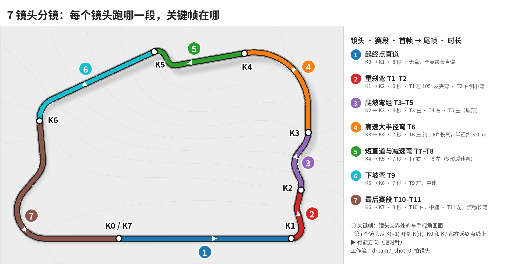

# 第 3 章：分镜

## 目标

把一圈拆成 7 个镜头，用关键帧把它们接起来，并把分镜写成一份能直接生成工作流的表格。

## 讲解要点

- **按赛道元素切镜头。** 地图上有 7 个元素，所以是 7 个镜头，每个 6–8 秒，在 H3 的 4–15 秒范围内。
- **镜头之间靠关键帧衔接。** 每个交界处一张车手视角的关键帧，K0 到 K7 共 8 张。第 i 个镜头用 K(i-1) 作首帧、K(i) 作尾帧（H3 首尾帧节点）。相邻镜头共用交界帧，所以能接上。
- **俯视图是剧本。** 它只用来决定每个镜头往哪边转、上坡还是下坡、有多快；真正喂给模型的是关键帧和描述动作的提示词。

| 镜头 | 赛段 | 首帧 → 尾帧 | 时长 | 弯道 |
|---|---|---|---|---|
| 1 | 起终点直道 | K0 → K1 | 8 秒 | 无弯 |
| 2 | 重刹弯 T1–T2 | K1 → K2 | 6 秒 | T1 左发夹弯，T2 右侧小弯 |
| 3 | 爬坡弯组 T3–T5 | K2 → K3 | 8 秒 | 左、右、左 |
| 4 | 高速大半径弯 T6 | K3 → K4 | 7 秒 | 左约 100° 长弯 |
| 5 | 短直道与减速弯 T7–T8 | K4 → K5 | 7 秒 | 右、左（S 形） |
| 6 | 下坡弯 T9 | K5 → K6 | 7 秒 | 下坡直道后接左弯 |
| 7 | 最后赛段 T10–T11 | K6 → K7 | 8 秒 | 右、左长弯 |

每种颜色是一个镜头跑的路段，圆圈是关键帧的位置。后面几章提到的 K0–K7、镜头 1–7、`dream7_shot_01` 到 `dream7_shot_07`，都可以回到这张图对照。拼接时右下角的小地图用的是同一套路径数据。

## 分镜表

`storyboards/lap_7shots.json` 是唯一的参数来源，`scripts/make_workflows.py` 根据它生成工作流和手册 `docs/storyboard_dream7.md`。

- `style`：统一风格（T-cam 机位、深蓝车身白色车头、晴天、灰色沥青和红白路肩），附加在每条提示词后面，保证各镜头看起来是同一辆车、同一天。
- `video_rules`：视频统一规则（一镜到底、不倒车、不出现文字和水印）。
- `keyframes[].scene`：每张关键帧的画面描述，第 4 章用。
- `shots[].motion`：每个镜头“怎么动”，第 5 章用。
- `video.takes = 2`：每个镜头 2 个候选。关键帧每张只生成 1 张，不对就改 `scene` 再生成（第 4 章）。
- `pilot`：试拍用的 K0、K1。

下一章先生成关键帧，再下一章逐段拍镜头。
