# 第 4 章：关键帧

## 目标

用 Qwen Image 2.1 为每个镜头交界处生成一张车手视角的关键帧，K0 到 K7 共 8 张；学会对照分镜检查，不对就改场景描述再生成；拍镜头之前，用图像编辑把所有关键帧的车身统一成 K1 的样子。

## 讲解要点

- **关键帧是镜头之间的“合同”。** 下一章的视频从首帧出发、必须到达尾帧；尾帧里画了什么，模型就会往哪里开。所以关键帧必须和地图一致，而不只是好看。
- **提示词 = 场景 + 风格。** 场景来自分镜表的 `keyframes[].scene`，描述这个位置车手看到什么，特别是前方的路往哪边弯；风格是所有关键帧共用的 `style`，保证机位、赛车和天气一致。
- **每张只生成 1 次，靠改描述迭代。** 节点没有随机种子，提示词不变时重新生成也是同一张图；在提示词末尾加几个字凑出的“候选”也几乎一样。画面不对时，要找出哪里和分镜不符，把它写进场景描述，再生成。
- **拍镜头之前先统一车身。** `style` 里写了赛车的样子，文生图还是每张各画各的车：halo 顶上的部件有大有小、车身有的带红色、机位有高有低。首尾帧是两辆车时，视频会在中途换车；相邻镜头又共用关键帧，所以一张不一致会牵连两个镜头。这一步要放在关键帧定稿之后、拍镜头之前。
- **统一车身用本地模型。** 编辑用的是本地 Qwen Image 2.1（3 个模型约 17 GB，需要本机 GPU）。

## 演示（浏览器）

1. `dream7_keyframes_pilot`：先只生成 K0、K1，看画风和机位是否满意。画风不满意就改 `storyboards/lap_7shots.json` 的 `style`，重新运行 `make_workflows.py --install` 再生成。
2. `dream7_keyframes`：生成全部 8 张。
3. 逐张对照分镜检查（见下面“检查什么”）。哪张不对，就在 ComfyUI 里改那个节点提示词开头的场景描述（`Photorealistic onboard` 之前的部分），再点 Run。ComfyUI 只会重新生成提示词改过的那张。ComfyUI 重启过的话，之前的结果不再缓存，点 Run 会把每张都重新生成；只想重做一张时，先选中其他行的 Save Image 节点，按 Ctrl+M 静音。
4. 定稿后复制进 ComfyUI 的 `input/`，文件名为 `dream7_K0.png` 到 `dream7_K7.png`。下一章镜头工作流的 `LoadImage` 只认这些文件名，工作流左侧的说明里有现成命令。改好的场景描述最好写回分镜表，否则下次重新运行 `make_workflows.py --install` 时会被覆盖。
5. `dream7_keyframes_edit`：以 `input/dream7_K1.png` 为参考图（image 2），把 K0、K2–K7（image 1）里的车改成 K1 那辆。缺模型时打开工作流会提示下载，说明节点里也列了文件名。
6. 逐张检查：车和 K1 是同一辆、机位高度一致；路面走向、弯道、红车、看台这些场景内容没被改掉。哪张不行就在它的指令里补一句，或者换一个 KSampler 的 seed 再运行（本地模型有 seed，和云端节点不一样）。满意后用 `K*_edit_00001_.png` 覆盖 `input/` 里对应的关键帧，命令在说明节点里。

实际项目里，定好 K0、K1 后应该先拍镜头 1 试一下，确认没问题再生成其余关键帧，免得画风不对时整批重来；`dream7_keyframes_pilot` 之后先跑 `dream7_keyframes_edit_pilot` 把 K0 的车统一成 K1 的，再拍镜头 1。这里直接往下走，镜头 1 放在下一章开头拍。

想跳过生成、直接往下做时，notebook 会把项目自带的关键帧（`examples/keyframes/dream7_K*.png`）复制进 `input/`。提示词和项目工作流完全一致；K1 是文生图的原图，其余是统一车身之后的版本，自带的视频就是用这些图拍的。

## 检查什么

- **前方路面的走向和分镜一致：** 该左转的图，路就要往左弯；远端只该有一个弯时，不能画出两个。**这一条最重要，第 7 章会看到原因。**
- **距离和比例对得上：** 直道有多长、离弯道多远，和小地图一致。
- **该有的东西都在：** 起终点的灯架、看台、红车这类后面镜头要用到的元素。终点 K7 的灯架要和起点 K0 是同一个：把 K0 灯架的样子逐项写进 K7 的场景描述（立柱、灯板、灯的数量、桁架下面挂不挂东西）。
- **和其他关键帧一致：** 镜头高度、halo 和座舱顶部在画面底部的位置。赛车外观的差异留给第 5、6 步的编辑统一，生成时不用为它反复改描述。

## 实例：对照地图修改 K0 的场景描述

下面是同一张 K0 的几次生成，每次找出一个和地图不符的地方，改一句场景描述，再生成。图在 `examples/k0_versions/`。

| 版本 | 图 | 对照分镜发现的问题 | 场景描述怎么改 |
|---|---|---|---|
| 1 | 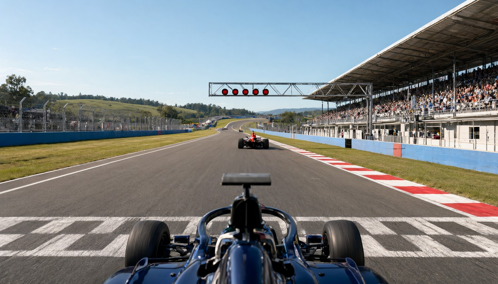 | 直道远端先左弯、再右弯、再上坡。从起终点线往前看，地图上只有 T1 一个左弯，四周是平地 | 写明直道笔直、几乎水平，尽头只有一个向左的急弯，周围平坦，路不爬坡 |
| 2 | 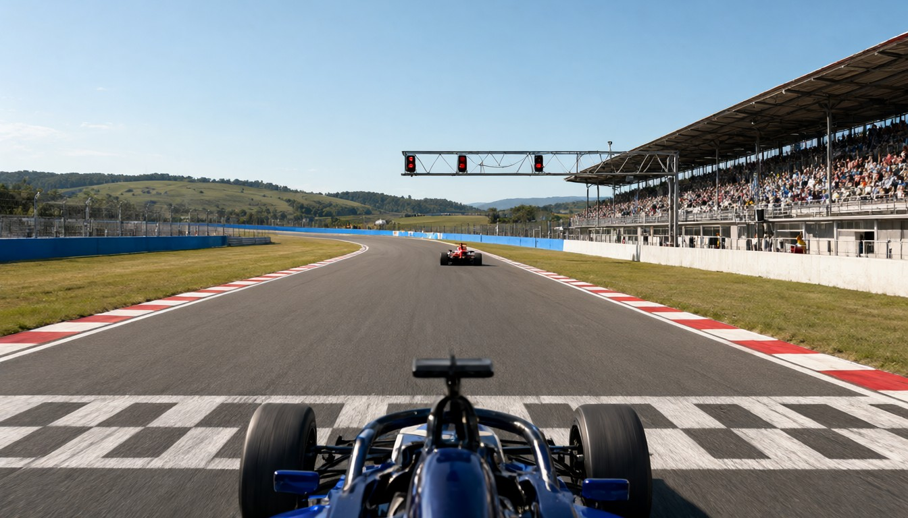 | 只剩一个左弯了，但离得太近，直道看起来只有两三百米；地图上这段直道约 1 km | 写明直道约 1 km、一直延伸到地平线附近的消失点，中间没有任何弯；左弯只在消失点处用一小段蓝色护墙暗示 |
| 3 | 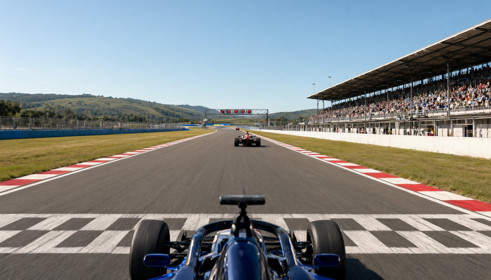 | 路对了，但起跑灯架远在红车后面，红灯只剩几个小点。镜头 1 起步时要从灯架下穿过，终点关键帧也要和它对应 | 写明灯架在车前约 20 米、占满画面上部，5 个大红灯清楚可见，红车停在灯架附近 |
| 4 | 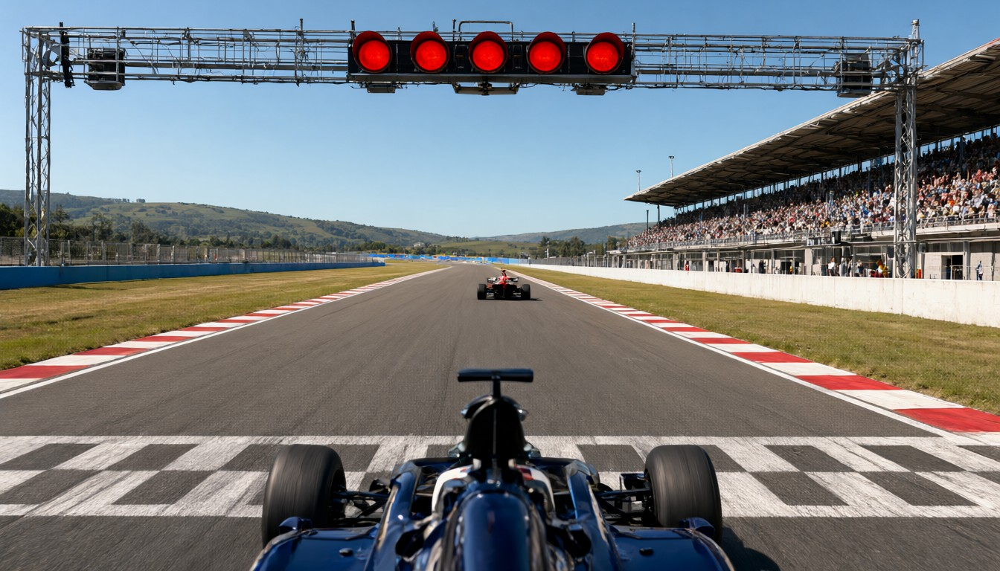 | 定稿 | |

每次只改一个问题，下一版才知道这一句改得对不对。

## 实例：统一车身

左边是文生图的原图，右边是以 K1 为参考编辑后的结果。图在 `examples/car_edit/`。

| 关键帧 | 编辑前 | 编辑后 | 变化 |
|---|---|---|---|
| K1（参考） | 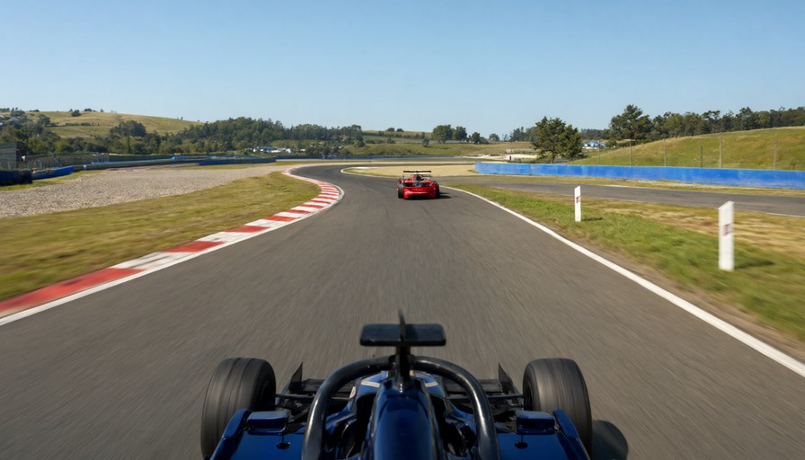 | | |
| K0 | 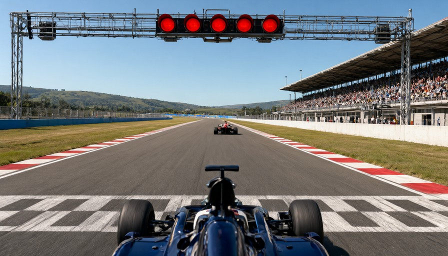 | 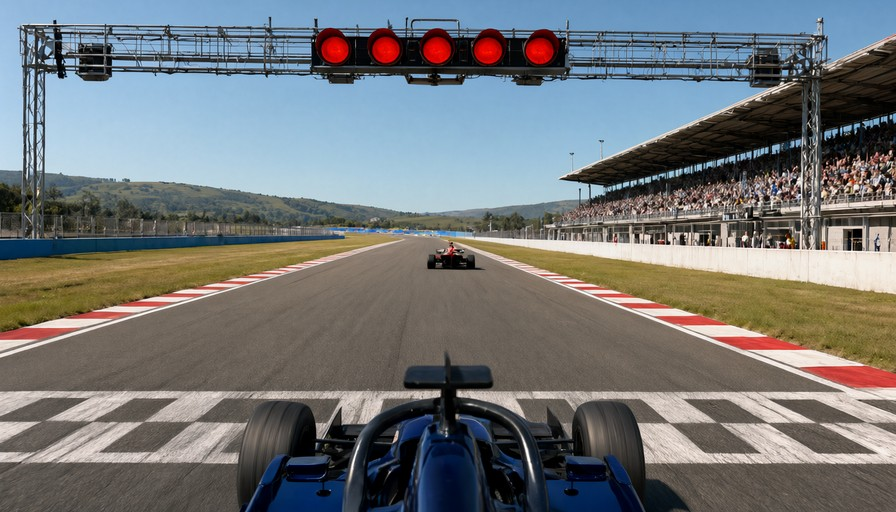 | 座舱两侧的白色部件去掉，换成 K1 的黑色 halo 和中柱顶上的扁平部件 |
| K2 | 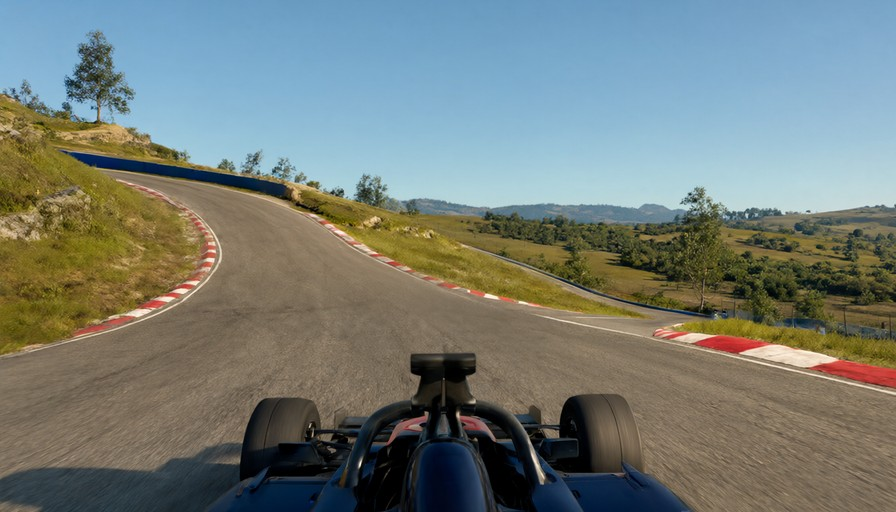 | 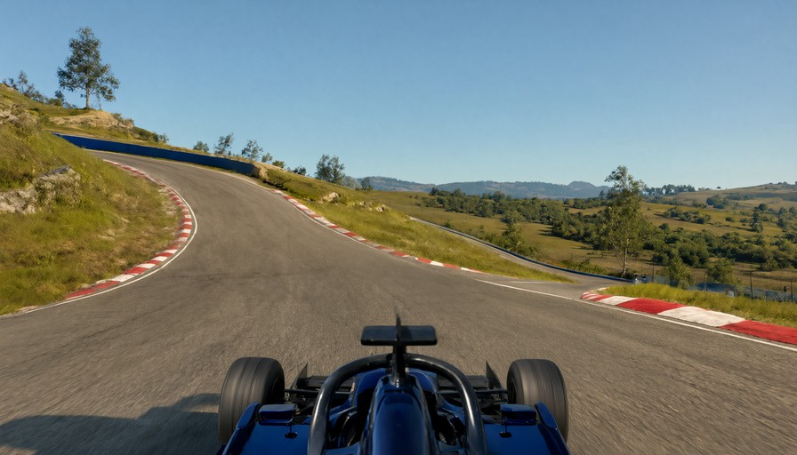 | 座舱里的红色部件去掉，halo 顶上的大方块换成 K1 的扁平部件 |
| K6 | 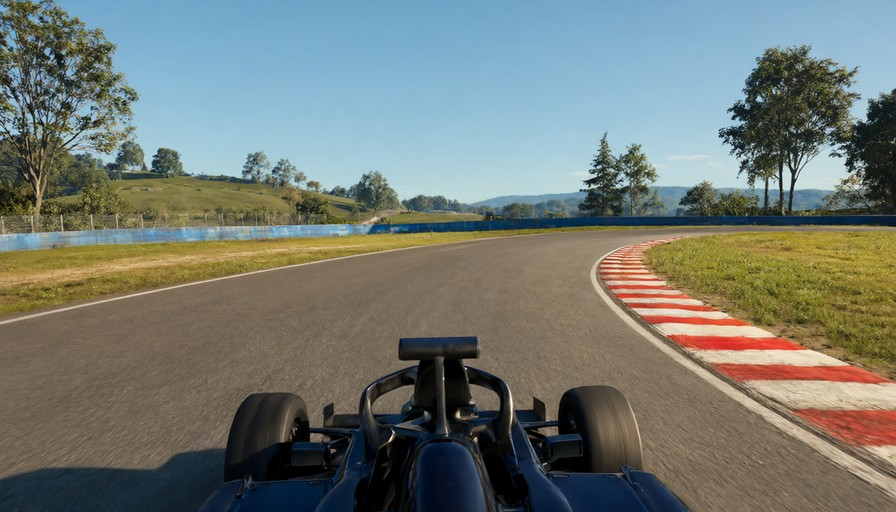 | 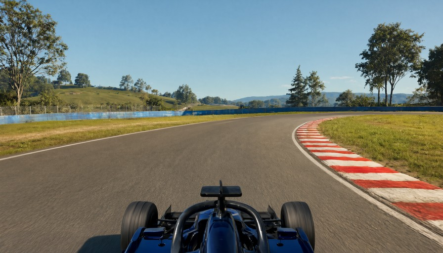 | 近乎黑色的车身换成 K1 的深蓝色，halo 顶上的大部件换成 K1 的 |

场景几乎不变：路面、路肩、护墙、看台、灯架都还在原来的位置，整体亮度变化在 4% 以内。
